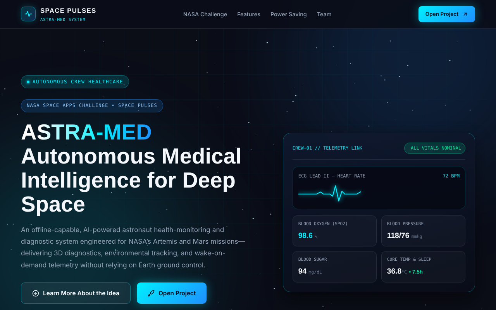
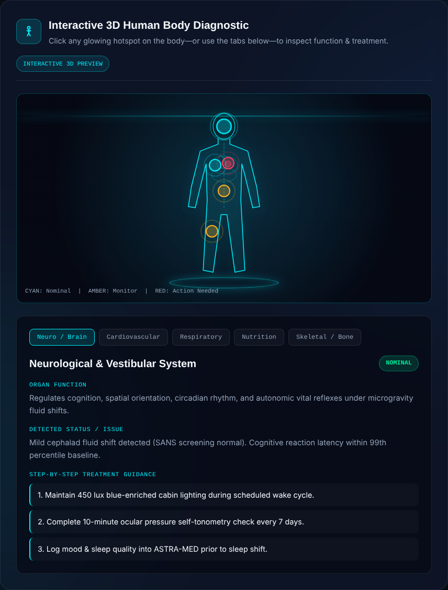

# 🚀 ASTRA-MED — Autonomous Astronaut Health System

**NASA Space Apps Challenge project by Team Space Pulses**

ASTRA-MED is an offline-capable, AI-powered health-monitoring and diagnostic concept for astronauts on NASA's Artemis and Mars missions. With communication delays of up to ~22 minutes, crews can't rely on live guidance from Earth, so ASTRA-MED brings diagnostics, alerts, and treatment guidance onboard.

🔗 **Live demo:** [mohammadateir.github.io/Space-Pulses-About](https://mohammadateir.github.io/Space-Pulses-About/)

🛰️ **Open Project:** [space-pulses.onrender.com](https://space-pulses.onrender.com/)



---

## 🌌 The Problem

Long-duration missions expose astronauts to NASA's **5 Hazards of Human Spaceflight**:

1. **Space radiation**
2. **Isolation and confinement**
3. **Distance from Earth**
4. **Altered gravity fields**
5. **Hostile closed environments**

Together these raise the risk of immune system changes, bone density loss, cardiovascular events, poor nutrition, and behavioral health issues. When Earth is minutes away by signal, astronauts need autonomous care.

## ✨ Features

| Module | Description |
|---|---|
| **7 Vitals Monitoring** | Tracks heart rate, blood pressure, SpO₂, blood sugar, body temperature, sleep hours, and mood/stress. |
| **Interactive 3D Body Diagnostic** | Click body hotspots (brain, cardiovascular, respiratory, nutrition, skeletal) to see organ function, detected status, and step-by-step treatment guidance. |
| **AI Personal Doctor Chatbot** | Onboard assistant for symptom triage and quick treatment protocols, designed to work offline. |
| **Environment, Radiation & Gravity Monitor** | Select a location (spacecraft, space station, lunar/Mars base, pressurized rover) to see radiation dose rate, local gravity, risk level, and recommended countermeasures. |
| **Preventive Dental Alerts** | Monthly reminders and a self-exam checklist to prevent in-flight dental emergencies. |
| **Wake-on-Demand Power Saving** | Dashboard stays in a **0.4 W** standby state until woken by a vital-sign anomaly (smartwatch wearable) or a touchless hand gesture. |



### Wake-on-Demand Modes

- **Biometric trigger:** a wrist-worn wearable samples vitals in the background and wakes the dashboard when a threshold is breached.
- **Computer vision trigger:** a hands-free gesture (open palm → closed fist) built on **Python, OpenCV, and MediaPipe Hands** (21-landmark tracking).

> **Note:** In this web demo, the wearable anomaly and hand gesture are **simulated** with buttons to show the concept. The vision pipeline runs separately in Python.

## 🛠️ Tech Stack

- **Frontend:** HTML, CSS, JavaScript (single-page, no build step)
- **Fonts:** Inter, JetBrains Mono, Orbitron (Google Fonts)
- **Vision module:** Python 3, OpenCV, MediaPipe
- **Hosting:** GitHub Pages

## 📂 Project Structure

```
.
├── index.html     # Full interactive web experience
├── images/        # README screenshots
└── README.md
```

## ▶️ Run Locally

No installation required.

```bash
git clone https://github.com/mohammadateir/Space-Pulses-About.git
cd Space-Pulses-About
```

Then open `index.html` in your browser, or serve it locally:

```bash
python -m http.server 8000
# visit http://localhost:8000
```

An internet connection is needed for the Google Fonts to load.

## 👥 Team — Space Pulses

| Name | Role |
|---|---|
| **Mohammad Ateir** ⭐ Team Leader | Electronics & Robotics Engineering — built the website, integrated the diagnostic tools and hardware/vision modules, and connected all system components. |
| **Mohammad Alzoubi** | Dentistry — graphic design, visual branding, and project presentation/slides. |
| **Kinda AbuBaker** | Dentistry — NASA spaceflight data research and the core healthcare and preventive dental ideas. |

## ⚠️ Disclaimer

ASTRA-MED is a hackathon concept built for the NASA Space Apps Challenge. Medical data, thresholds, and treatment guidance shown in the demo are illustrative and **not intended for real medical use**.

## 🙏 Acknowledgments

Built for the [NASA Space Apps Challenge](https://www.spaceappschallenge.org/).
